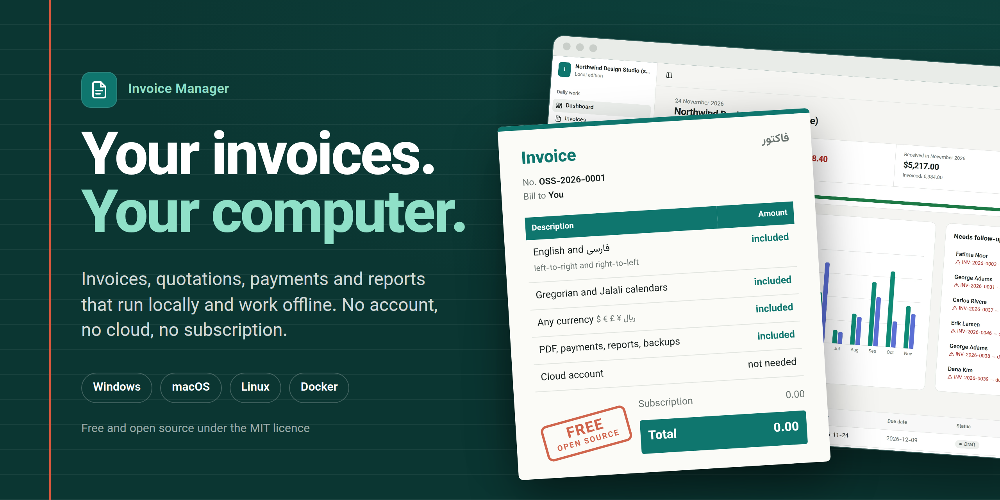
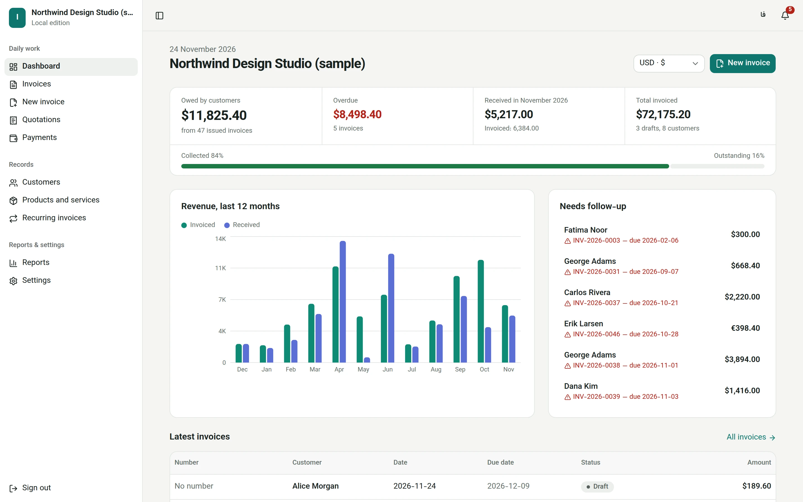
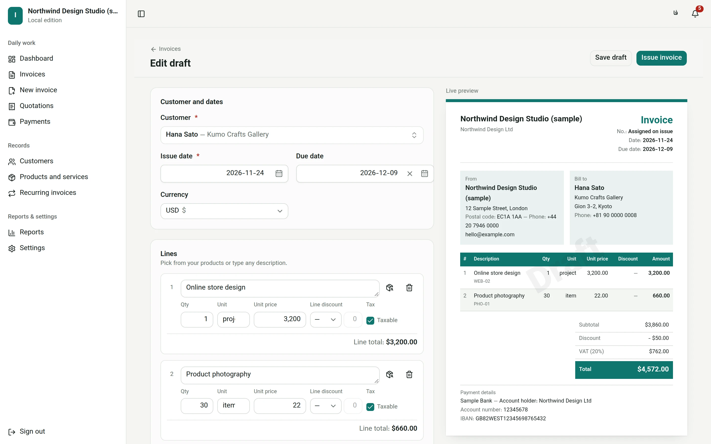
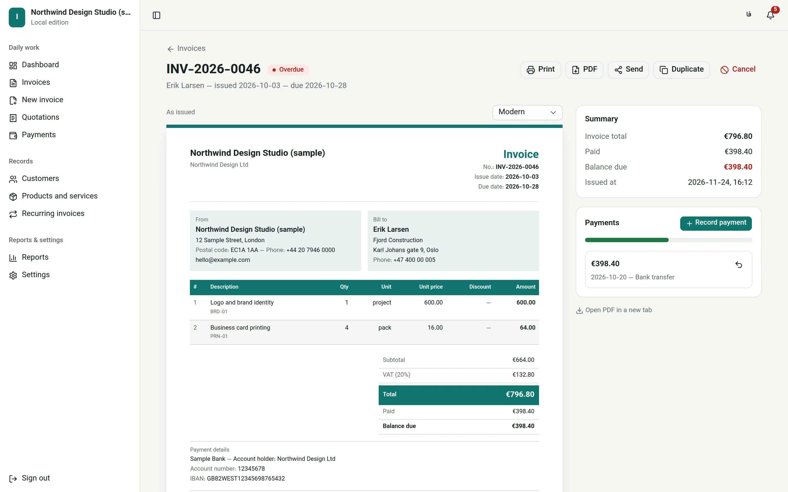
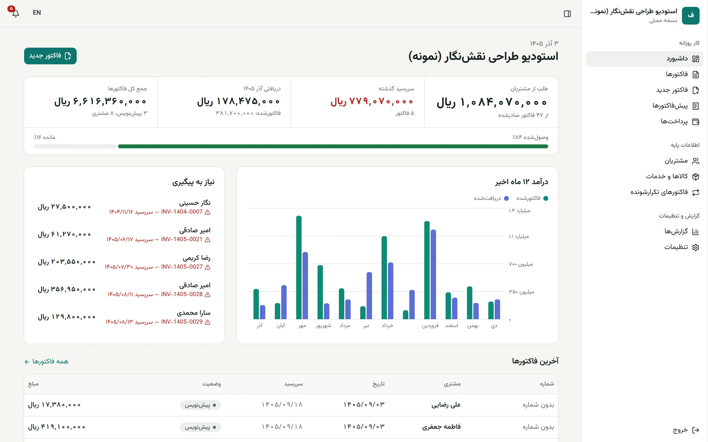
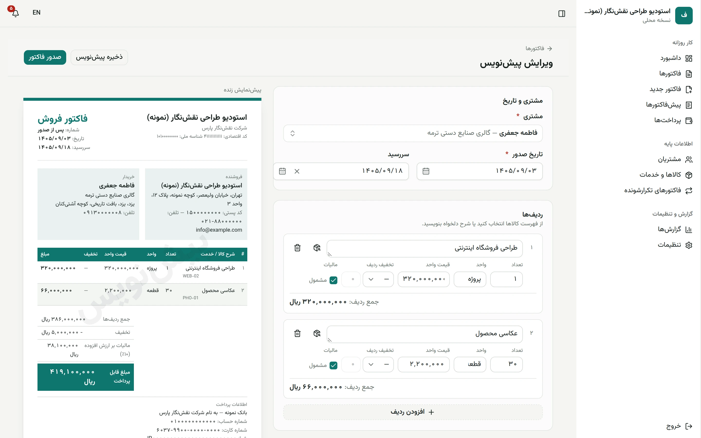
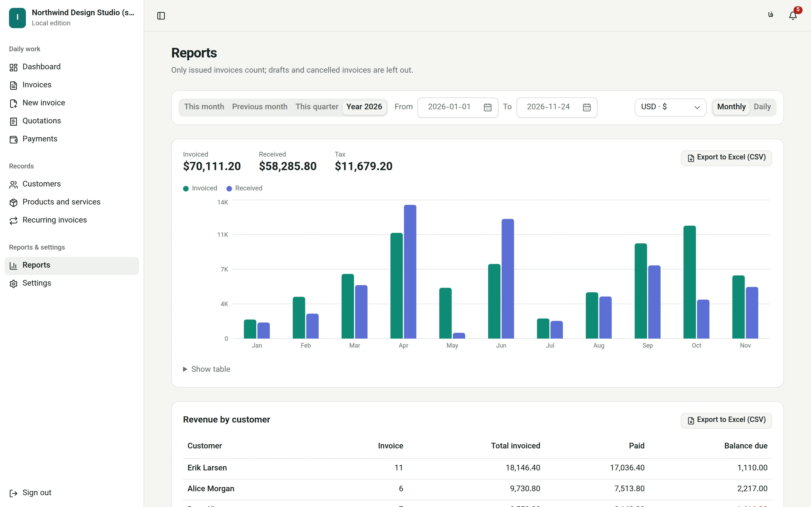
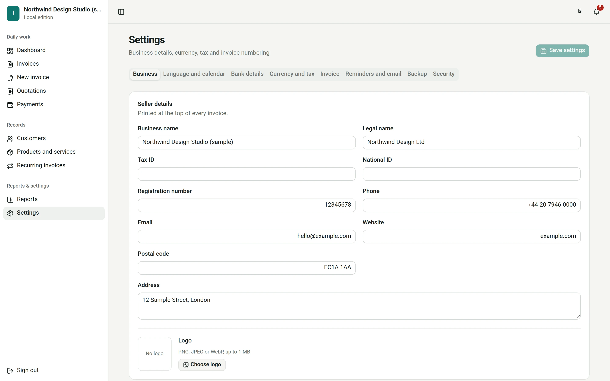
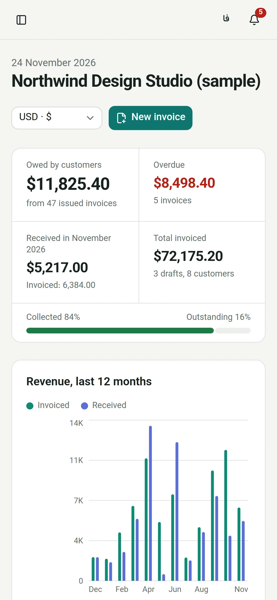

<p align="center">
  
</p>

<p align="center">
  <a href="https://github.com/mgmehdiforme/local-invoice-manager/releases/latest"></a>
  <a href="https://github.com/mgmehdiforme/local-invoice-manager/actions/workflows/ci.yml"></a>
  <a href="LICENSE"></a>
  
  
</p>

<p align="center">
  <b>Invoices, quotations, payments and reports that run on your own computer.</b><br />
  No account. No cloud. No subscription. Works offline.
</p>

<p align="center">
  <a href="#install">Install</a> ·
  <a href="#screenshots">Screenshots</a> ·
  <a href="#features">Features</a> ·
  <a href="docs/USER_GUIDE.md">User guide</a> ·
  <a href="docs/USER_GUIDE.fa.md">راهنمای فارسی</a>
</p>

---

## Why Invoice Manager?

Most invoicing tools want an account, a monthly fee and your customers' data on their servers. Invoice Manager is a small app you install like any other program. It opens in your browser at `localhost`, keeps everything in one local database, and backs itself up every day.

| | Invoice Manager | Typical online invoicing |
|---|---|---|
| Where your data lives | On your computer | On the vendor's servers |
| Account / sign-up | None | Required |
| Price | Free, open source | Monthly subscription |
| Works offline | Yes | No |
| Persian (RTL) + Jalali calendar | Built in | Rarely |

## Screenshots

<p align="center"></p>

<table>
  <tr>
    <td width="50%"><br /><sub><b>Invoice editor</b> with a live A4 preview. Totals are calculated by the server.</sub></td>
    <td width="50%"><br /><sub><b>Invoices in any currency</b>, with partial payments and a running balance.</sub></td>
  </tr>
  <tr>
    <td width="50%"><br /><sub><b>Persian, right-to-left</b>, with the Jalali calendar and Rial.</sub></td>
    <td width="50%"><br /><sub>The same editor in Persian. Switch language from the header at any time.</sub></td>
  </tr>
  <tr>
    <td width="50%"><br /><sub><b>Reports</b> by month, day or customer, with CSV export for Excel.</sub></td>
    <td width="50%"><br /><sub><b>Several currencies</b>: each document keeps its own, reports never mix them.</sub></td>
  </tr>
</table>

<p align="center"><br /><sub>Responsive down to phone size.</sub></p>

## Features

**Billing**
- Invoices with live A4 preview, line and invoice discounts, tax, amount in words
- Unique numbering that never repeats, even under concurrent use (`INV-2026-0001`)
- PDF in three templates (modern, classic, minimal), print, duplicate, cancel with reason
- Quotations that convert to invoices once, keeping lines, prices and currency
- Recurring invoices (weekly to yearly), as drafts or issued automatically

**Money**
- Partial and multiple payments, reversals with history (bounced cheques)
- Overdue tracking, customer balances, special prices per customer
- Dashboard, revenue and customer reports, CSV export

**Global**
- English and Persian UI, PDFs, e-mails and messages; LTR and RTL layouts
- Gregorian or Jalali calendar for dates, numbering, schedules and reports
- Any number of currencies; amounts in different currencies are never added together

**Yours**
- Local SQLite database, listens on `127.0.0.1` only, works fully offline
- Password lock, idle timeout, sign-in lockout, CSRF protection
- Daily backups with SHA-256 checks, verify and one-click restore with a safety copy
- WhatsApp share and optional SMTP e-mail with the PDF attached

## Install

### Windows
Open **PowerShell** and run:
```powershell
irm https://raw.githubusercontent.com/mgmehdiforme/local-invoice-manager/main/install/install.ps1 | iex
```
This installs to `%LOCALAPPDATA%\LocalInvoiceManager`, adds Start menu and desktop shortcuts, and opens the app.

### macOS and Linux
```bash
curl -fsSL https://raw.githubusercontent.com/mgmehdiforme/local-invoice-manager/main/install/install.sh | bash
```
Start it later with `invoice-manager` (or from the applications menu on Linux).

### Manual download
Download the archive for your system from [Releases](https://github.com/mgmehdiforme/local-invoice-manager/releases/latest), unpack it and run `InvoiceManager` (`InvoiceManager.exe` on Windows). Your browser opens **http://localhost:8090**.

| System | File |
|---|---|
| Windows (64-bit) | `InvoiceManager-win-x64.zip` |
| macOS (Apple Silicon) | `InvoiceManager-osx-arm64.tar.gz` |
| macOS (Intel) | `InvoiceManager-osx-x64.tar.gz` |
| Linux (x64 / ARM64) | `InvoiceManager-linux-x64.tar.gz` / `InvoiceManager-linux-arm64.tar.gz` |

The builds are not code-signed. If you download with a browser, Windows SmartScreen may show "More info → Run anyway"; on macOS run `xattr -dr com.apple.quarantine InvoiceManager` in the unpacked folder. The install scripts above are not affected.

Options: `--port 9000` (another port), `--no-browser`. Set `LIM_HOME` to keep data somewhere else.

### Docker
```bash
docker run -d --name invoice-manager --restart unless-stopped \
  -p 127.0.0.1:8090:8080 -e TZ=Europe/London \
  -v invoice-data:/data -v "$PWD/backups":/backups \
  ghcr.io/mgmehdiforme/local-invoice-manager:latest
```
Or build from source with Docker Compose: `bash scripts/install.sh` (uses `.env`, see `.env.example`).

## First run
Open http://localhost:8090. Choose the language, calendar and default currency, set a password, then fill in **Settings** (business details, bank details, tax, numbering). To try the app with fictional data on an empty install:

```bash
invoice-manager seed-demo
```
(Docker: `docker exec invoice-manager dotnet LocalInvoiceManager.Web.dll seed-demo`.)

## Where your data lives
| Install | Data and backups |
|---|---|
| Windows | `%LOCALAPPDATA%\LocalInvoiceManager` |
| macOS | `~/Library/Application Support/LocalInvoiceManager` |
| Linux | `~/.local/share/LocalInvoiceManager` |
| Docker | volume `invoice-data` (`/data`) and the folder mounted on `/backups` |

Updating (running the installer again, or pulling a new image) keeps your data; a safety backup is made before any database upgrade. Copy a backup to another disk from time to time.

Forgot the password? Data is kept: run `invoice-manager reset-password` (Docker: `docker exec invoice-manager dotnet LocalInvoiceManager.Web.dll reset-password`), then open the app and set a new one.

## Guides
- English user guide: [docs/USER_GUIDE.md](docs/USER_GUIDE.md) · راهنمای فارسی: [docs/USER_GUIDE.fa.md](docs/USER_GUIDE.fa.md)
- Architecture: [docs/ARCHITECTURE.md](docs/ARCHITECTURE.md) · Database: [docs/DATABASE.md](docs/DATABASE.md) · API: [docs/API.md](docs/API.md)
- Security: [docs/SECURITY.md](docs/SECURITY.md) · Backup: [docs/BACKUP.md](docs/BACKUP.md) · Requirements: [docs/PRD.md](docs/PRD.md) · Phase reports: [docs/phases/](docs/phases/)

## Development
Requirements: .NET SDK 10, Node 24.

```bash
cd backend && ASPNETCORE_ENVIRONMENT=Development dotnet run --project src/LocalInvoiceManager.Web
```

```bash
cd frontend && npm install && npm run dev
```

The API runs on `http://localhost:5080`, the UI on `http://localhost:5173` (it proxies `/api`).

Tests:

```bash
cd backend && dotnet test
```

```bash
cd frontend && npm test && npm run i18n:check && npm run build
```

Every user-visible string goes through `t("…")` (frontend) or `Loc.T("…")` (backend), with the English text in `frontend/src/i18n/en/` and `backend/src/LocalInvoiceManager.Domain/Localization/En.cs`. `npm run i18n:check` fails on untranslated text.

Release: push a tag such as `v1.0.0`. GitHub Actions builds the downloads (`scripts/publish-native.sh`) and the Docker image, and publishes the release.

## Stack
.NET 10 · ASP.NET Core minimal APIs · EF Core + SQLite (WAL) · FluentValidation · QuestPDF · MailKit · React 19 + TypeScript · Tailwind CSS 4 · shadcn/ui · TanStack Query · Recharts · Vazirmatn. No CDN or online service at runtime.

## FAQ

**Is my data sent anywhere?** No. The app makes no network calls except the optional e-mail you configure. Fonts, icons and components are bundled.

**Can other people on my network open it?** No. It listens only on `127.0.0.1`.

**Can I move it to another computer?** Install it there, then restore a backup file from **Settings › Backup**.

**Does it handle VAT / sales tax?** Yes: a default tax rate and label (VAT, GST, Sales tax…), per-line taxable switch, discounts before tax.

**Is it multi-user?** No. It is a single-user app for one business on one computer.

## Contributing
Issues and pull requests are welcome. Please run the tests (see [Development](#development)) and keep every user-visible text translatable (`npm run i18n:check`). Larger changes: open an issue first to discuss.

## Licence
MIT, see [LICENSE](LICENSE). Bundled parts: Vazirmatn font (SIL Open Font License). QuestPDF is used under its Community licence, which is free for individuals and businesses with less than USD 1M yearly revenue; larger businesses need a QuestPDF commercial licence.
